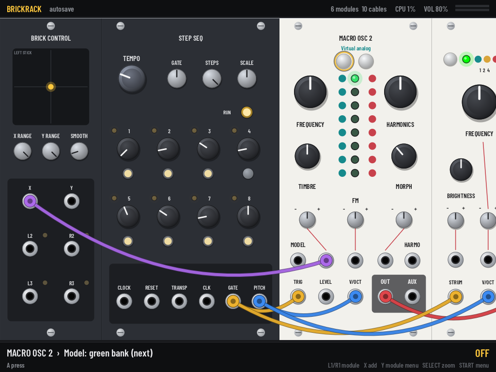
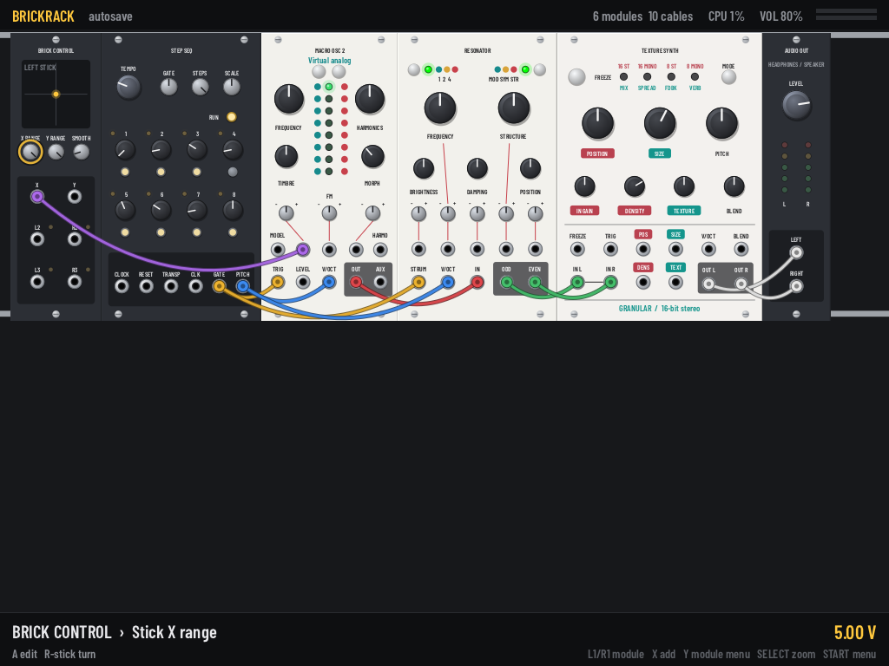

# BrickRack

A pocket modular synthesizer for the **TrimUI Brick Pro** running **NextUI**. It
contains ports of the open-source Eurorack module firmware published by Émilie Gillet,
plus digital models of the analog modules from the same range. You patch them together
with cables, VCV Rack style, on the Brick Pro's 1024×768 screen.

The digital modules run the **original firmware DSP code** from the upstream repository.
Two headers are patched at build time to fix an upstream regression and remove a debug
`printf` (see [notes](#notes-on-the-firmware-code)). The three 8-bit AVR modules are
faithful re-implementations, because their sources depend on AVR assembly.



> **Status:** v0.1. Builds and runs on desktop, and builds for the device (aarch64,
> glibc ≥ 2.27, SDL2). **It has not been run on real hardware yet.** The face buttons,
> D-pad, shoulders, START/SELECT and the sticks use the same SDL GameController mapping
> as the GrainBrick native app, which is known to work on the device. **L2/R2 and L3/R3
> are unverified.** Run with `--input-debug` (the events go to the log) if a button is
> mis-mapped.
>
> Target is the **Brick Pro**: its analog sticks turn knobs and drive the Brick Control
> module. The original Brick (no sticks) can still use every module through the D-pad
> edit mode. Other tg5040 devices with a different screen size are untested and would be
> letterboxed.

## Modules

29 modules. Names are descriptive (see [Trademarks](#credits--licenses)). The original
module each one is based on is shown in the browser.

| Module | Based on | Source |
|---|---|---|
| Macro Oscillator 2 | Plaits | firmware DSP, 48 kHz |
| Macro Oscillator | Braids | firmware DSP, 96 kHz |
| Quad Chiptune Oscillator | Edges | AVR firmware reproduced: ch. 4 line by line with firmware tables (48048 Hz); ch. 1-3 band-limited pulses at the firmware's exact timer frequencies |
| Resonator | Rings | firmware DSP, 48 kHz |
| Modal Synthesizer | Elements | firmware DSP, 32 kHz |
| Meta Modulator | Warps | firmware DSP, 96 kHz |
| Texture Synthesizer | Clouds | firmware DSP, 32 kHz |
| Texture Synthesizer 2 | Beads | firmware DSP, 24/32/48 kHz |
| Tidal Modulator | Tides | firmware DSP (2015 version), 48 kHz |
| Tidal Modulator 2 | Tides (2018) | firmware DSP, 62.5 kHz |
| Random Sampler | Marbles | firmware DSP, 32 kHz |
| Segment Generator | Stages | firmware DSP, 31.25 kHz |
| Dual Trigger Converter | Peaks | firmware DSP, 48 kHz |
| Dual Dynamics Gate | Streams | firmware DSP (31.089 kHz) + model of the analog VCA/VCF |
| Keyframer / Mixer | Frames | firmware keyframer + model of the output VCAs |
| Topographic Drum Sequencer | Grids | AVR firmware algorithm reproduced (8012.8 Hz tick), firmware tables |
| Dual Bernoulli Gate | Branches | AVR firmware algorithm reproduced, firmware table |
| Liquid Filter | Ripples | digital model of the analog circuit |
| Dual Multimode Filter | Blades | digital model |
| EQ Filter | Shelves | digital model |
| Quad VCA | Veils | digital model |
| Quad VC Polarizer | Blinds | digital model |
| Triple Attenuverter | Shades | digital model |
| Buffered Mult / Mixer | Links | digital model |
| Rectifier / Logic / S&H | Kinks | digital model |
| Audio Out | | headphones / speaker |
| Brick Control | | left stick → X/Y CV, L2 / R2 / L3 / R3 → gates |
| Mic In | | built-in mic with envelope follower and gate |
| Step Sequencer | | 8 steps of pitch and gate, clock, quantizer |

**How the firmware runs.** Each module runs its firmware at the hardware's own sample
rate and block size, so pitch tables, filters and timing match the hardware. The
audio modules (Braids, Elements, Warps, Clouds, Beads, Tides 2, Edges ch. 4) cross
into the 48 kHz engine through a windowed-sinc converter (`src/core/resampler.h`).
Gate/CV-heavy modules (Marbles, Stages, Streams, Frames) are clocked at their native
rate with sample-and-hold or linear interpolation instead, because a sinc filter would
ring on gate edges. Plaits, Rings, Peaks and Tides already run at 48 kHz.
Panel layouts follow the original faceplates. Settings the hardware reaches through
button combinations or hold-while-turning gestures are "hidden parameters" in each
module's menu.

## Controls

| Button | Action |
|---|---|
| D-pad | Move between knobs, buttons and jacks (moves across modules) |
| **A** on a knob | Edit mode: D-pad ↑↓ coarse, ←→ fine, Y = default, A/B = done |
| Right stick | Turn the selected knob directly |
| **A** on a jack | Start a cable, then **A** on another jack to connect |
| **B** on a jack | Unplug the cables on that jack. **B** while patching cancels |
| **A** on a button | Press: momentary buttons are held while A is held, latching ones toggle |
| **A** on a switch | Step to the next position |
| L1 / R1 | Previous / next module |
| **X** | Add a module to the right of the current one |
| **Y** | Module menu: hidden settings, all parameters, move, duplicate, reset, delete |
| SELECT | Zoom: overview (multi-row) / normal / close-up |
| START | Main menu: save, load, new patch, demo patch, volume, help, quit |
| L2 / R2, L3 / R3 | Gates on the **Brick Control** module |
| Left stick | X/Y voltages on **Brick Control** |
| START + SELECT, or MENU | Quit confirmation: *Save and quit* / *Cancel* (MENU first closes any open menu) |
| L1 / R1 in a menu | Page up / down |

The status bar always shows the selected control's full name and value, or a jack's
live voltage.



## Install (NextUI)

1. Download `BrickRack-tg5040.zip` from Releases, or build it (below).
2. Copy the `Tools/tg5040/BrickRack.pak` folder to `/Tools/tg5040/` on the SD card.
3. Start **BrickRack** from *Tools*.

Patches are stored in `/.userdata/tg5040/BrickRack/patches/` on the SD card, so they
survive app updates. The rack is autosaved on quit and every minute. Example patches
(the demo, one using every module, and one per module) are copied there as
`example-*.brp`. Missing ones are restored at each launch; edited ones are never
overwritten. The log goes to `/.userdata/tg5040/logs/BrickRack.txt`.

## Building

```sh
git clone --recursive https://github.com/andrewfrangella/brickrack.git
cd brickrack
```

**Device (Docker):** builds inside Debian Bullseye arm64 (GCC 10, glibc 2.31), then
packages `dist/Tools/tg5040/BrickRack.pak` and `dist/BrickRack-tg5040.zip`. Apple
Silicon and other arm64 hosts run the container natively. x86-64 hosts need arm64
emulation (QEMU/binfmt, which Docker Desktop includes).

```sh
./scripts/build-device.sh
```

**Desktop (macOS / Linux, needs SDL2):**

```sh
cmake -S . -B build && cmake --build build -j
./build/brickrack            # window; keyboard: arrows, Z=A, X=B, C=X, V=Y, Q/E=L1/R1,
                             # Enter=START, Tab=SELECT, Esc=MENU, 1/3=L2/R2,
                             # IJKL=right stick, TFGH=left stick
```

Headless tools, useful for development and CI:

```sh
./build/brickrack --list-modules
./build/brickrack --patch demo --screenshot out.png [--focus N] [--widget W] [--zoom 0|1|2] \
                  [--menu main|module|browser] [--frames N]
./build/brickrack --patch tests/patches/resonator.brp --render-wav out.wav --seconds 5 \
                  [--gate-every S]                       # pulses the Brick Control L2 gate
./build/brickrack --patch tests/patches/all-modules.brp --bench --seconds 10   # DSP cost
./build/brickrack --bench-ui [--zoom Z]                  # UI frame time
./build/brickrack --patch demo --save-patch demo.brp     # write a patch file
./build/brickrack --input-debug                          # print raw button/axis events
./build/brickrack --demo                                 # open the window with the demo patch
./build/resampler_test                                   # sample-rate adapter test
```

`--patch` takes a file or the word `demo`. Patches and the autosave live in
`--data DIR`, else `$BRICKRACK_HOME`, else `data/` next to the binary.

Adding a module: see [docs/MODULE_GUIDE.md](docs/MODULE_GUIDE.md).

## Performance

The UI is a software renderer that draws into one texture, with static panel art
cached. Audio runs on SDL's audio thread (48 kHz, 1024-frame buffer; change it with
`BRICKRACK_BUFFER`).

Measured with `--bench` / `--bench-ui` on the device build, in an arm64 container on an
Apple M-series host:

| Workload | Cost |
|---|---|
| `tests/patches/all-modules.brp`: one of every module, unpatched, so a floor rather than a worst case | 5.4% of one core |
| Demo patch | 1.1% |
| One UI frame | 2.5 ms |

The Brick's Cortex-A53 is much slower than that host, roughly 10–15× by estimate, so
expect real-world numbers to be higher. The top bar shows live DSP load.

## Notes on the firmware code

The `third_party/eurorack` submodule is used unmodified. A few build-level workarounds
let it compile and run as a desktop program:

* Everything compiles with `-DTEST`, the firmware's own desktop-test configuration.
  `src/core/mi_prelude.h` is force-included to supply standard headers that older
  toolchains pulled in implicitly.
* **Clouds:** two 2023 upstream clean-up commits (fbb53ba, 0e3756f) each removed one of
  the duplicated `done_ = false;` lines in `Window::Start()`, and the merge lost both.
  That silences the stretch mode. `src/modules/clouds.cmake` compiles against a
  build-time copy of `window.h` with the line restored, which is the behaviour of the
  shipped firmware.
* **Beads:** a `printf` that `-DTEST` enables in the audio path is removed in a
  build-time header copy (`beads.cmake`).
* **Tides / Tides 2** share a namespace, so the 2015 version is compiled with
  `-Dtides=tides2015`.
* Grids, Branches and Edges are AVR firmwares whose sources depend on avrlib/avrlibx
  assembly. Their algorithms are reproduced line by line in the wrappers. Grids and
  Edges `#include` the firmware's own `resources.cc`; Branches' small table is copied
  from its `branches.cc`. Edges' pulse channels 1-3 (hardware timers on the module) are
  rendered as band-limited pulses at the firmware's exact timer frequencies.

## Credits & licenses

* **Eurorack firmware** by Émilie Gillet
  ([pichenettes/eurorack](https://github.com/pichenettes/eurorack)). The STM32 code is
  MIT-licensed; the AVR code is GPL-3.0-or-later. The hardware designs (CC-BY-SA-3.0)
  were the reference for the analog-module models. Full notices are in
  `THIRD_PARTY_NOTICES`, which also ships in the pak.
* **Trademarks:** "Mutable Instruments" is a registered trademark. The upstream
  repository asks that derivative works not use that name, and recommends against
  keeping the module names. This project uses descriptive names and no MI branding;
  the original module names appear only as "after …" attribution. BrickRack is not
  affiliated with or endorsed by Mutable Instruments.
* **Barlow Condensed** font: SIL Open Font License (`third_party/fonts/OFL.txt`).
* **stb_truetype / stb_image_write** by Sean Barrett: public domain / MIT.
* **BrickRack** itself is licensed under **GPL-3.0-or-later** (see `LICENSE`).
